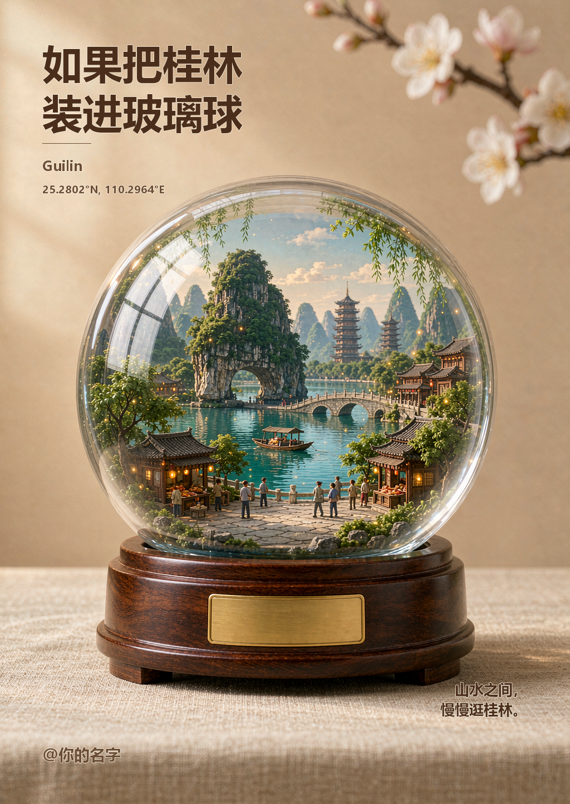
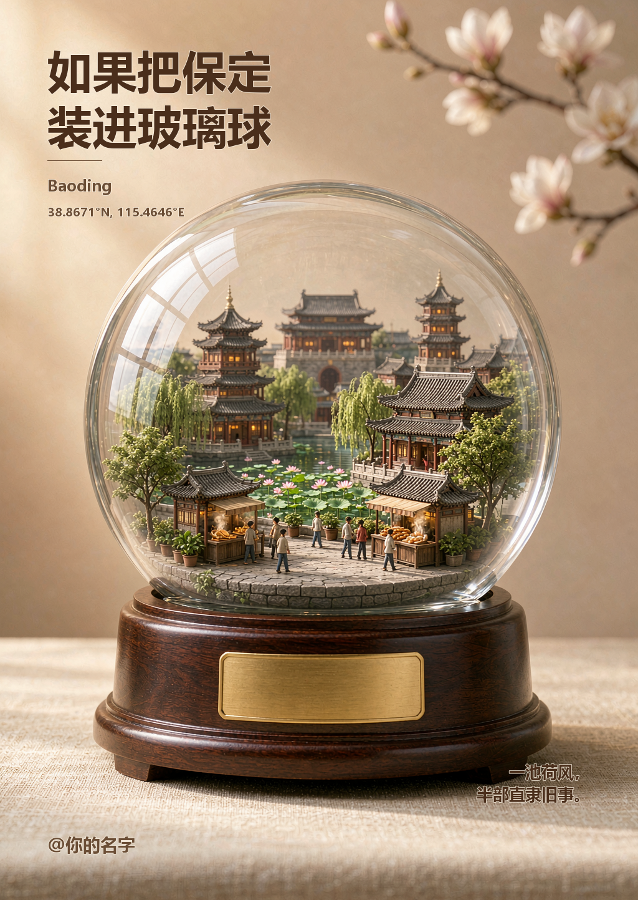

# 城市装进玻璃球 · City in a Glass Globe

> 给 WorkBuddy 一句话城市名，自动生成「把整座城市装进透明玻璃球」的微缩城市文创海报。

## DEMO

<table>
<tr>
<td align="center" width="50%"><br><br><b>桂林</b><br>漓江峰林 · 象鼻山 · 日月双塔 · 竹筏</td>
<td align="center" width="50%"><br><br><b>保定</b><br>荷池垂柳 · 古城楼阁 · 驴肉火烧摊</td>
</tr>
</table>

🖼️ [打开在线 DEMO 画廊](https://iithink88.github.io/city-glass-globe/)（在仓库 Settings → Pages 开启，Source 选 `main` / `root`）

成品为 1024×1443 竖版：一只完整透明水晶玻璃球，内装该城市的微缩全景，深胡桃木圆底座、空白金色铭牌、暖米色背景与虚化花枝，配中文标题、英文名、经纬度和一句短文案。

## 特点

- **一句话出图**：城市名 → 地标 → 提示词 → 生图 → 中文排版 → 成品海报
- **中文零乱码**：画面里不让 AI 写任何文字，标题／坐标／文案全部用系统中文字体后期绘制
- **40+ 城市档案**：内置地标、季节、色调、经纬度与短句；任意未收录城市也能出图
- **5 种风格**：`poster`（默认）／`snow`／`night`／`ink`／`clean`
- **无密钥**：技能与仓库不含任何 API Key、账号或私人路径

## 安装

1. 下载本仓库 ZIP（或 `Releases` 中的技能包）。
2. 把 `city-glass-globe/` 整个文件夹放进 WorkBuddy 技能目录：
   - Windows：`%USERPROFILE%\.workbuddy\skills\`
   - macOS / Linux：`~/.workbuddy/skills/`
   - 最终应为 `.../skills/city-glass-globe/SKILL.md`（不要多套一层目录）
3. 安装 Pillow（仅排版脚本需要）：`python3 -m pip install pillow`
4. 重启 WorkBuddy 或刷新技能列表，直接对话即可。

更详细的手把手步骤见 [安装说明.md](安装说明.md)。

## 使用

```
把苏州装进玻璃球
用 city-glass-globe 生成保定
批量生成 北京 上海 西安 的玻璃球海报
换成雪景风格再做一次哈尔滨
```

脚本层面（技能会自动执行，手动调试时才需要）：

```bash
python3 scripts/build_prompt.py 桂林 --outdir out/guilin
# 把生成的 桂林_prompt.txt 全文交给图像生成工具（建议 1024x1536 / high）
python3 scripts/add_text_overlay.py 生成的图.png \
  --meta out/guilin/桂林_meta.json --out out/guilin/桂林_海报.png --hide-watermark
```

## 依赖

| 项目 | 说明 |
|---|---|
| Python 3.9+ | `build_prompt.py` 只用标准库 |
| Pillow | `add_text_overlay.py` 中文排版叠加 |
| WorkBuddy 图像生成能力 | 单张约 5–10 积分，批量前会先告知 |

## 目录结构

```
city-glass-globe/
├── SKILL.md                       技能工作流与硬性规则
├── scripts/
│   ├── build_prompt.py            城市名 → 中英双份提示词 + 排版元数据
│   └── add_text_overlay.py        中文标题／坐标／文案叠加 + 无痕去水印
├── references/
│   ├── cities.json                40+ 城市地标素材库（可增长）
│   └── style-guide.md             视觉规范、风格变体、失败排错
├── demo/                          桂林、保定成品图
├── examples/                      两份可直接复用的提示词
├── index.html                     在线 DEMO 画廊（GitHub Pages）
└── 安装说明.md
```

## 可调项

| 需求 | 做法 |
|---|---|
| 换季节／夜景／国风／极简 | `--style snow\|night\|ink\|clean` |
| 地标画错、认不出 | `--landmarks` 指定 4–6 个真实地标后重生成 |
| 加强玻璃质感等细节 | `--extra "加强玻璃边缘高光与折射"` |
| 改文案、署名 | `--slogan` / `--signature`，**只重跑排版脚本，不重新生图，省积分** |
| 纯图不要文字 | 跳过排版脚本 |

## 常见问题

- **AI 生成的中文乱码？** 提示词已强制「画面不出现任何文字、店招与铭牌留空白」，文字全部后期绘制。
- **右下角有平台「AI生成」水印？** `--hide-watermark` 裁掉底部 6% 桌布留白，无痕，且画幅更接近 3:4。
- **古建画得不够像？** 纯文字提示词对单体建筑还原力有限。提供一张参考图走图生图（`image1` + 较高 `input_fidelity`）效果最好，或用 `--landmarks` 写得更具体。
- **球被裁切／出现两只球？** 保持提示词末尾的【必须遵守】约束，画幅用 `1024x1536` 竖版。

## 声明

- 本仓库**不含任何 API Key、账号或私人路径**；左下角署名默认 `@你的名字`，分享前请替换。
- 视觉规范提炼自公开文章《把一座城市装进玻璃球里，AI创意太有意思了！》，**仓库内 DEMO 图均为本技能生成的原创效果，未使用他人原图**。
- 仅供学习交流与教学演示；落地商用前请自行核对地标授权与平台生成内容的使用条款。
